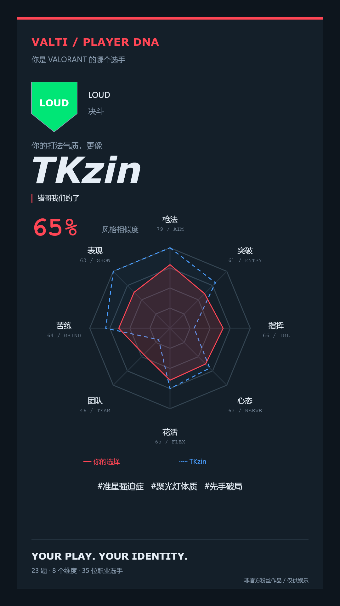

# VALTI / PLAYER DNA

「你是 VALORANT 的哪个选手」粉丝向人格测试。23 道题（20 道情境题 + 3 道枪法专项）、35 位选手、8 个维度，所有计算与历史记录都在浏览器本机完成。

## 使用

下载仓库 ZIP 并解压，双击 **index.html** 即可使用。请保留同目录的 `styles.css`、`data.js`、`app.js`。不需要安装、不需要后端、不需要构建，运行时没有 CDN 或网络请求。也可把四个文件直接放到任意静态网站空间。

本地记录按浏览器与来源分别保存；本地文件版和网站版不共享记录。浏览器限制本地存储时仍可完成测试，但无法保证刷新后恢复。

## 本机调试器

Windows 双击 **start-debugger.cmd**，或执行 `node tools/debugger/server.cjs`，再打开 **http://127.0.0.1:4174/**。可编辑题目、权重、选手和队伍，预览结果、运行随机分布检查，以及导入导出 JSON。仅需 Node.js 22+，不需要 npm 安装。

调试服务只在本机监听。草稿与备份保存在被 Git 忽略的 `.valti-debug/`；只有点击“写入本地数据”才修改 `data.js`，不会自动推送。完整操作见 [调试器说明](tools/debugger/README.md)。

公众网站发布前运行 `node scripts/package-public.cjs`，只部署生成的 **dist/**；该目录不包含调试器。仓库源码仍然公开。

## 功能

- 固定 23 题、每题四个选项，180ms 自动切题，支持回退修改和键盘 1–4。
- 三道枪法专项：中等靶平均成绩、急停首发、马枪处理；均按 A > B > C > D 计分。
- 自动保存进度，恢复未完成答卷；保留最近 50 次结果。
- 校准后的八维雷达与选手参考虚线、位置与指挥标签、混合结果。
- 保留旧版 20 题历史、迁移未完成的旧答卷；旧结果可只补答三道枪法题，生成独立的新结果。
- 35 份 80–110 字人设，包含缺点；基于实际答案的名场面、位置自白、互补拍档。
- 35 格解锁图鉴，按四个主位置筛选。混合结果同时解锁两人。
- Canvas 生成 1080×1920 PNG，可下载或在手机上长按保存。
- 作者原始描述（`note`）逐字展示在结果主卡与 PNG 分享卡上；扩写的打法解读放在下方独立区域。
- SVG 盾形队徽，不包含官方 Logo、真人照片或外部字体。

## 数据与算法

默认 `data.js` 中的 `DATA` 集中保存原始 35 位选手、39 支队伍、八维定义、23 道题和新版计分配置。默认选手数据与前 20 题保持交接版本；调试器可以编辑当前配置。原始默认配置另存于测试夹具，供算法回归检查使用。队伍是交接时的数据快照，不表示实时阵容。

### 新版分数（scoringVersion: 2）

前 20 题先累加原始分，并实时计算各维度最大值，得到 `rawPct = 100 × raw / max`。基础风格指数使用 `20 + 80 × sqrt(rawPct / 100)`，范围为 20–100；例如原始 25 → 60、52 → 约 78、55 → 约 79。基础 20 分是展示量尺的起点，不代表未被问卷观察到的能力。此变换保留同维度分数的高低关系，缓解八维分摊造成的普遍低分。

枪法专项只给 AIM 赋分：A = 100、B = 75、C = 45、D = 15。三题内部权重为中等靶 50%、急停首发 30%、马枪处理 20%。最终 `AIM = 75% × 专项加权分 + 25% × 基础枪法指数`，不再对最终 AIM 套用抬分曲线。变更这三题的答案不会影响其余七维分数。

实际匹配和雷达均使用最终八维值。用户与选手分别去均值 → 加权余弦 → 主位置 ×1.08 / 副位置 ×1.03 → 排名。AIM 的余弦权重从旧版 0.9 提升到 1.2，其余维度权重保持原样。展示相似度使用未经位置修正的余弦，限制到 0–100%。雷达不使用去均值后的值，选手参考值仍为原始向量 ×10。

### 旧版兼容（scoringVersion: 1）

已有 20 题历史继续使用原来的归一化、0.9 枪法余弦权重和匹配算法，不虚构缺失的专项答案。结果页明确标记旧版；点击「补答 3 道枪法题」会保留原答卷，从第 21 题继续，完成后生成独立的新版历史。旧版未完成答卷自动扩展到 23 题，保留原有进度。

前两名最终分差小于 0.02 时显示混合结果。交接未指定混合比例公式，本实现对两名最终分做温度系数 30 的 softmax，四舍五入；同分为 50% / 50%。混合比例与“风格相似度”分别显示。互补拍档为与用户去均值向量加权余弦最低的另一位选手。

## 检查

Node.js 22 或更新版本下，无需安装依赖即可运行：

```sh
node --test tests/scoring.test.cjs
node --test tests/active-data.test.cjs tests/debugger.test.cjs
node tests/distribution.cjs
```

固定种子 `20261103` 的 1,000 份新版随机答卷覆盖 **35 / 35** 位选手，最高单人占比 **10.1%**；各维均分约 **60–65**，原始版本约 **26–32**。完整分布和前后均分见 [distribution-report.json](tests/distribution-report.json)。该样本结果不代表所有真实用户的分布。

DOM 与 Canvas 验证记录见 [QA.md](QA.md)。**真实浏览器中的 375 / 414 / 768 / 1440 宽度布局、文件协议行为及实际下载交互尚未完成验证**：浏览器工具因无法可靠识别 Windows 浏览器地址而中止。程序检查与 PNG 生成通过，不将其视为真实浏览器验收。



## 文件

| 文件 | 用途 |
| --- | --- |
| `index.html` | 页面入口及静态导航 |
| `styles.css` | 深色界面与移动端样式 |
| `data.js` | 交接数据及固定题库 |
| `app.js` | 纯计分函数、流程、本地存储、SVG 与 Canvas |
| `tests/` | 计分测试、可复现分布检查、可选 DOM 检查 |

非官方粉丝作品，未获 Riot Games 或相关战队授权。测试描述是娱乐化的打法气质映射，不是实力评估或职业建议。选手名字、游戏名称等权利归各自权利人所有。
